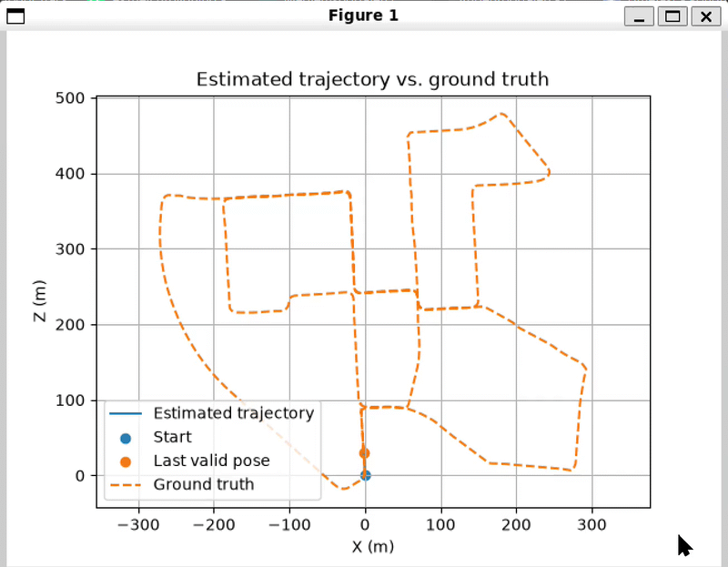
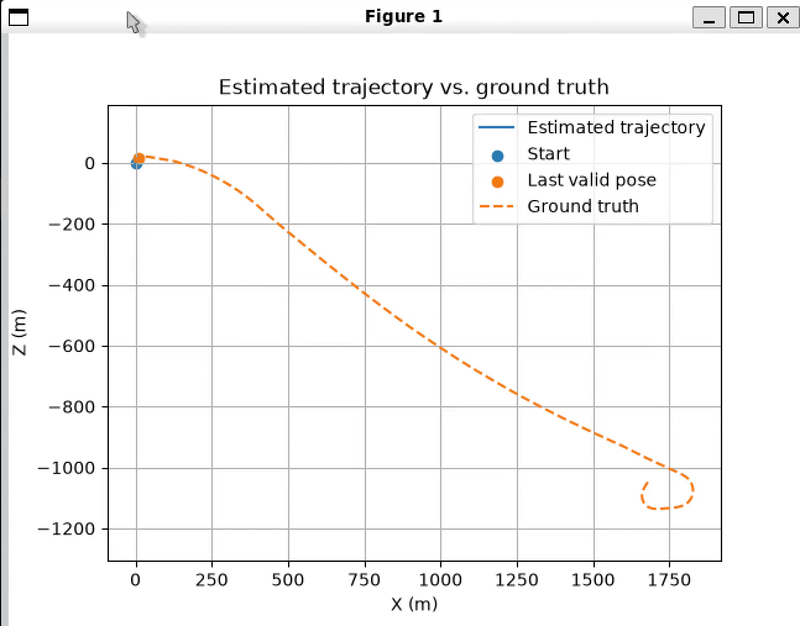

# Stereo Visual Odometry

I created this project to learn more about computer vision. It estimates
visual odometry on KITTI stereo sequences, using SIFT by default (ORB is also
available). For each rectified stereo pair, it matches features and uses
their horizontal pixel offset, the pinhole camera model, and the calibrated
baseline to triangulate metric 3-D points. It then matches features between
consecutive left images and estimates frame-to-frame motion from 3-D-to-2-D
correspondences using PnP with RANSAC. Levenberg-Marquardt refines
the pose using the RANSAC inliers. The PnP transform is inverted and
accumulated into a camera trajectory.

This is a stereo VO baseline without loop closure or drift correction. When PnP fails, the last accepted motion is reused, so that pose is a prediction rather than a new visual measurement.

## Results

The animations below show sample runs on KITTI sequences 00 and 01 using SIFT. They are
sped up and show only portions of each run, not the entire trajectory.

<table>
  <tr>
    <td align="center"><strong>Sequence 00</strong></td>
    <td align="center"><strong>Sequence 01</strong></td>
  </tr>
  <tr>
    <td></td>
    <td></td>
  </tr>
</table>

## Setup

Install dependencies:

```bash
python -m pip install -r requirements.txt
```

Place KITTI grayscale images and odometry poses under `data/kitti/`:

```text
data/kitti/data_odometry_gray/dataset/sequences/00/
    calib.txt
    times.txt
    image_0/
    image_1/
data/kitti/data_odometry_poses/dataset/poses/00.txt
```

## Run

From the repository root:

```bash
python src/main.py
```

Defaults to sequence `00` with SIFT. Choose another sequence or use ORB:

```bash
python src/main.py --sequence 01 --features orb
```

The program displays the estimated trajectory and saves estimated and
ground-truth poses to `results/estimated_trajectories/`. Failed PnP estimates
reuse the last accepted motion.

## Evaluate

With [`evo`](https://github.com/MichaelGrupp/evo):

```bash
evo_ape kitti results/estimated_trajectories/00_gt.txt results/estimated_trajectories/00.txt --align --plot --plot_mode xz
evo_rpe kitti results/estimated_trajectories/00_gt.txt results/estimated_trajectories/00.txt --plot --plot_mode xz
evo_traj kitti results/estimated_trajectories/00_gt.txt results/estimated_trajectories/00.txt --plot --plot_mode xz
```

## Future work

Local bundle adjustment could reduce local drift, and loop closure could
correct drift when revisiting a location. Sensor fusion is another possible extension which may yield better accuracy, but it would involve creating e.g EKF and integrating LiDAR or IMU data, which serves better in a new project repo.
